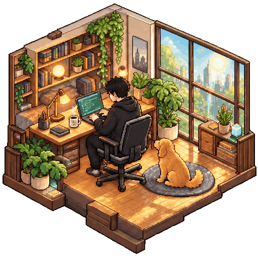
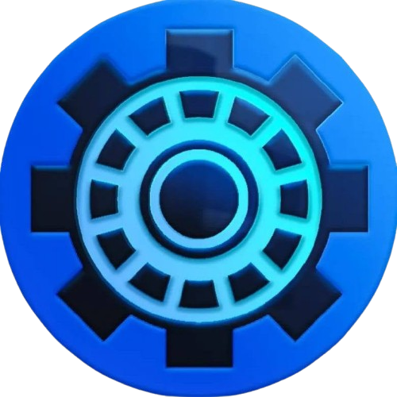

  <h1>REX LATAYADA</h1>

  

    <strong>IoT &amp; Software Developer</strong> 
    Building practical systems where hardware, software, and creativity meet.
  

  

    
    
  

 

<h2>&gt; whoami</h2>

  

Hello! I am **Rex Jemar B. Latayada**, a **Bachelor of Science in Information Technology** student at the **Technological University of the Philippines - Manila**.

I enjoy understanding how systems work from the inside out, then turning that knowledge into useful applications. My interests sit at the intersection of **IoT development, cybersecurity, embedded systems, and application development**.

When I am away from my editor, I spend time playing musical instruments, singing, and creating poster paintings.

<h2>&gt; current_focus</h2>

<table>
  <tr>
    <td width="50%" valign="top">
      <h3>Systems</h3>
      
Embedded hardware, Arduino projects, and connected devices designed around real-world use cases.

    </td>
    <td width="50%" valign="top">
      <h3>Software</h3>
      
Desktop, web, mobile, and game applications with an emphasis on clear interfaces and reliable behavior.

    </td>
  </tr>
  <tr>
    <td width="50%" valign="top">
      <h3>Security</h3>
      
Learning how to identify exposed secrets and build safer development workflows.

    </td>
    <td width="50%" valign="top">
      <h3>Growth</h3>
      
Always learning, always building, and looking for better ways to solve technical problems.

    </td>
  </tr>
</table>

<h2>&gt; tech_stack</h2>

<table>
  <tr>
    <td width="50%" valign="top">
      <h3>Languages</h3>
      

      

  <code>C</code>&nbsp;&nbsp;
  <code>C++</code>&nbsp;&nbsp;
  <code>Python</code>&nbsp;&nbsp;
  <code>Java</code>&nbsp;&nbsp;
  <code>JavaScript</code>&nbsp;&nbsp;
  <code>Dart</code>

    </td>
    <td width="50%" valign="top">
      <h3>Web Development</h3>
      

      

  <code>HTML5</code>&nbsp;&nbsp;
  <code>CSS3</code>&nbsp;&nbsp;
  <code>JavaScript</code>&nbsp;&nbsp;
  <code>Node.js</code>&nbsp;&nbsp;
  <code>Express.js</code>

    </td>
  </tr>
  <tr>
    <td width="50%" valign="top">
      <h3>Mobile Development</h3>
      

      

  <code>Flutter</code>&nbsp;&nbsp;
  <code>Dart</code>&nbsp;&nbsp;
  <code>Android</code>

    </td>
    <td width="50%" valign="top">
      <h3>IoT &amp; Embedded Systems</h3>
      

      

  <code>Arduino</code>&nbsp;&nbsp;
  <code>ESP32</code>&nbsp;&nbsp;
  <code>ESP8266</code>&nbsp;&nbsp;
  <code>Embedded C/C++</code>&nbsp;&nbsp;
  <code>Microcontrollers</code>

    </td>
  </tr>
  <tr>
    <td width="50%" valign="top">
      <h3>Database &amp; Backend</h3>
      

      

  <code>MySQL</code>&nbsp;&nbsp;
  <code>SQL</code>&nbsp;&nbsp;
  <code>Node.js</code>&nbsp;&nbsp;
  <code>Express.js</code>&nbsp;&nbsp;
  <code>REST API</code>

    </td>
    <td width="50%" valign="top">
      <h3>Tools &amp; Development</h3>
      

      
&nbsp;&nbsp;

      

  <code>Git</code>&nbsp;&nbsp;
  <code>GitHub</code>&nbsp;&nbsp;
  <code>VS Code</code>&nbsp;&nbsp;
  <code>Figma</code>&nbsp;&nbsp;
  <code>Arduino IDE</code>&nbsp;&nbsp;
  <code>Android Studio</code>&nbsp;&nbsp;
  <code>Linux</code>

  <code>Fritzing</code>&nbsp;&nbsp;
  <code>Tinkercad</code>

    </td>
  </tr>
</table>

<h2>&gt; affiliations</h2>

<table align="center" width="100%">
  <tr>
    <td width="50%" align="center" valign="top">
      
<strong>SCHOOL</strong>

      

      
<strong>Technological University of the Philippines</strong>

    </td>
    <td width="50%" align="center" valign="top">
      
<strong>ORGANIZATION</strong>

      

      
<strong>TUP Grayhawks Robotics</strong>

    </td>
  </tr>
</table>

<h2>&gt; connect</h2>

 

  

  

